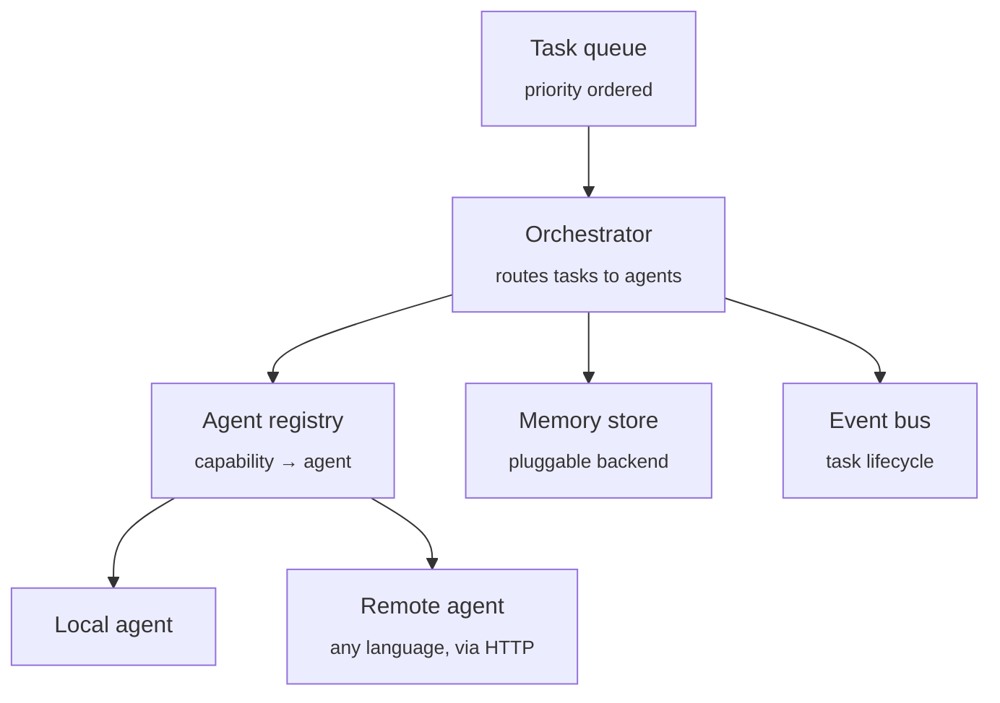

<div align="center">

# Atlas Core

**A language-agnostic orchestration core for autonomous, agent-driven SaaS platforms.**

[](LICENSE)
[](.github/workflows/ci.yml)
[](tsconfig.json)
[](CONTRIBUTING.md)
[](package.json)

[Quick start](#quick-start) · [Concepts](#core-concepts) · [Architecture](#architecture) · [Contributing](#contributing)

</div>

---

## What is this?

A wave of products — autonomous "AI runs your company" platforms — all rebuild the same foundation: something that queues work, hands it to the right agent, remembers context across steps, and reports what happened in real time.

**Atlas Core is that foundation, extracted and open-sourced.** It is not a product. It is the reusable engine underneath one: a small, dependency-free orchestration layer you can build a SaaS automation platform on top of, instead of writing it from scratch.

## Why it's different

- **Language-agnostic by design.** Agents run in-process or as remote services in any language — Python, Go, Rust — behind a tiny HTTP/JSON contract. The core only ever depends on interfaces, never implementations.
- **Minimal surface, zero bloat.** No framework lock-in, no ORM, no bundled LLM SDK. ~15 focused files. Read the whole core in an afternoon.
- **Observable from day one.** Every task lifecycle event streams through a typed event bus — the same primitive a live activity dashboard would consume.
- **Pluggable memory.** Ship with an in-memory store for development; swap in Redis, Postgres, or a vector store in production by implementing one interface.

## Architecture



The orchestrator never talks to an agent's implementation — only to the `Agent` interface. A `RemoteAgent` satisfies that interface by forwarding the call over HTTP, which is what makes a polyglot agent fleet possible without touching the core.

## Core concepts

| Concept | Role |
|---|---|
| **Task** | A unit of work: a required `capability`, a `payload`, and a `threadId` for shared context. |
| **Agent** | Anything that can execute a task for a given capability — local class or remote HTTP service. |
| **Orchestrator** | Queues tasks, resolves the right agent by capability, executes, emits events. |
| **MemoryStore** | Persistent context shared across tasks in the same thread. Bring your own backend. |
| **EventBus** | Typed pub/sub for `task.queued` / `task.started` / `task.completed` / `task.failed`. |

## Quick start

```bash
npm install @atlas/core
```

```ts
import { Orchestrator, BaseAgent } from '@atlas/core';
import type { Task } from '@atlas/core';

class PlannerAgent extends BaseAgent {
  readonly name = 'planner';
  readonly capabilities = ['plan.marketing'];

  protected async handle(task: Task) {
    return { plan: `Launch a campaign for: ${task.payload}` };
  }
}

const orchestrator = new Orchestrator();
orchestrator.register(new PlannerAgent());

orchestrator.events.on((event) => console.log(event.type));
orchestrator.submit({ capability: 'plan.marketing', payload: 'new product launch' });

await orchestrator.run();
```

Need an agent written in another language? Point the orchestrator at it instead:

```ts
import { RemoteAgent } from '@atlas/core';

orchestrator.register(
  new RemoteAgent({
    name: 'python-copywriter',
    capabilities: ['write.copy'],
    endpoint: 'http://localhost:8000/agents/copywriter',
  }),
);
```

See [`examples/basic-usage.ts`](examples/basic-usage.ts) for a complete runnable example.

## Project structure

```
src/
├── task/          Task definition and priority queue
├── agent/         Agent interface, base class, remote HTTP bridge, registry
├── memory/        MemoryStore interface and in-memory reference implementation
├── events/        Typed event bus for task lifecycle observability
├── protocol/      Wire format for polyglot remote agents
└── orchestrator/  The execution engine that ties it all together
```

## Roadmap

- [x] Orchestration engine, agent interfaces, memory, events
- [ ] Persistent `MemoryStore` adapters (Redis, Postgres)
- [ ] HTTP API server for language-agnostic task submission
- [ ] Reference agent implementations (planning, coding, ops)
- [ ] Plugin/connector system for third-party integrations

## Contributing

Contributions are welcome — from a bug fix to a new memory adapter. Please read [CONTRIBUTING.md](CONTRIBUTING.md) before opening a pull request, and note that this project follows a [Code of Conduct](CODE_OF_CONDUCT.md). All code, comments, and documentation are in English.

## License

[MIT](LICENSE)
